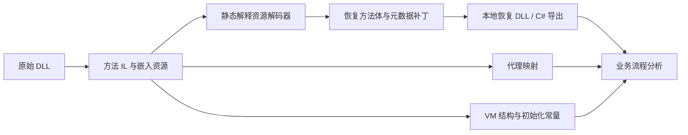

# 01：从占位 IL 到可分析方法

## 要解决的问题

初始 `WITRNUP.dll` 中大量业务方法只有短占位 IL。保护初始化会从资源恢复真实方法体；直接看初次 C# 导出会误以为业务逻辑缺失。研究必须先恢复方法体，再处理代理调用和 VM 常量，最后才解释业务控制流。

## 恢复流程与对应产物

| 阶段 | UP V30 定位 | 工具 | 核查内容 |
| --- | --- | --- | --- |
| 方法与资源导出 | 原始 MethodDef / 嵌入资源 | `reverse/inspect_dotnet.py` | RID、RVA、IL 与资源字节 |
| 方法资源解码 | RID 665 | `reverse/unpack_static.py` | 静态解释资源读取、运算和数组输出，不运行 DLL |
| 方法恢复 | 解码记录中的原代码 RVA | `reverse/restore_methods.py` | 650 处补丁、1269 条记录、方法体长度与资源消费 |
| 代理解码 | RID 624，解释范围偏移 113 至 886 | `reverse/extract_delegates.py` | 4592 字节、574 对字段 / 目标 token |
| VM 解析 | 初始化 RID 1768；分派 RID 1624 的既有分析 | `reverse/parse_vm.py` | 两个程序的结构；特定初始化路径的 118 个常量 |

统计是特定输入的结果，依据见 [原报告](../reverse/REPORT.md) 与 [历史验证摘要](../evidence/dotnet-validation.json)。

## C# 导出如何使用

C# 导出是恢复 DLL 的反编译视图，不是厂商原始源码。混淆后的类型 / 方法名、扁平 switch、代理调用和自动生成语法仍存在；文件名相似也不代表职责相同。先用 MethodDef RID / token 定位方法，再解析代理目标，不能只凭混淆名字判断函数用途。

公开的 [1269 条恢复方法索引](functions/upv30-methods.json) 把原始方法元数据和恢复清单连接起来，包含限定名、token、原始方法 RVA、原代码 RVA、恢复 RVA 和代码长度。它不包含 IL 或 C# 函数体。恢复 RVA 只用于这一份恢复 DLL，不能用于原始文件地址定位。

[574 组代理映射](functions/upv30-proxies.json) 给出字段 token、目标 token、目标名称与 virtual 标记；其中目标可能是 MethodDef 或 MemberRef，不能把所有 token 低 24 位都当作 MethodDef RID。

## 两个程序集不能共用参数

| 项目 | UP V30 | K2Picture 1.1 |
| --- | --- | --- |
| 方法资源解码入口 | RID 665 | RID 724，IL 偏移 14604 |
| 解码资源长度 | 292208 | 347982 |
| 元数据 / 头部补丁 | 650 | 688 |
| 方法记录 | 1269 | 1330 |
| 代理解码 / 数量 | RID 624 / 574 | RID 683 / 674 |
| 输出数组提示 | 现有脚本的 UP V30 局部变量 | local 53 |

K2Picture 数据来自 [专题报告](../reverse/K2PICTURE.md)，此次没有对应恢复清单可供同样的自动索引连接，因此不能把 UP V30 的机器可读方法索引扩展成 K2Picture 的已复核元数据。

## 验证与缺口

本次整理检查了 UP V30 索引的 RID 唯一性、token 编码、1269 条记录连接、574 组映射及关键函数定位。没有重新执行资源恢复流水线；历史“方法体均可解析”的结论来自已有摘要。完整 VM 语义、跨版本恢复、K2Picture 参数化恢复和 Qt 一键分析尚不完整。复现顺序见 [reproduction.md](../docs/reproduction.md)。
